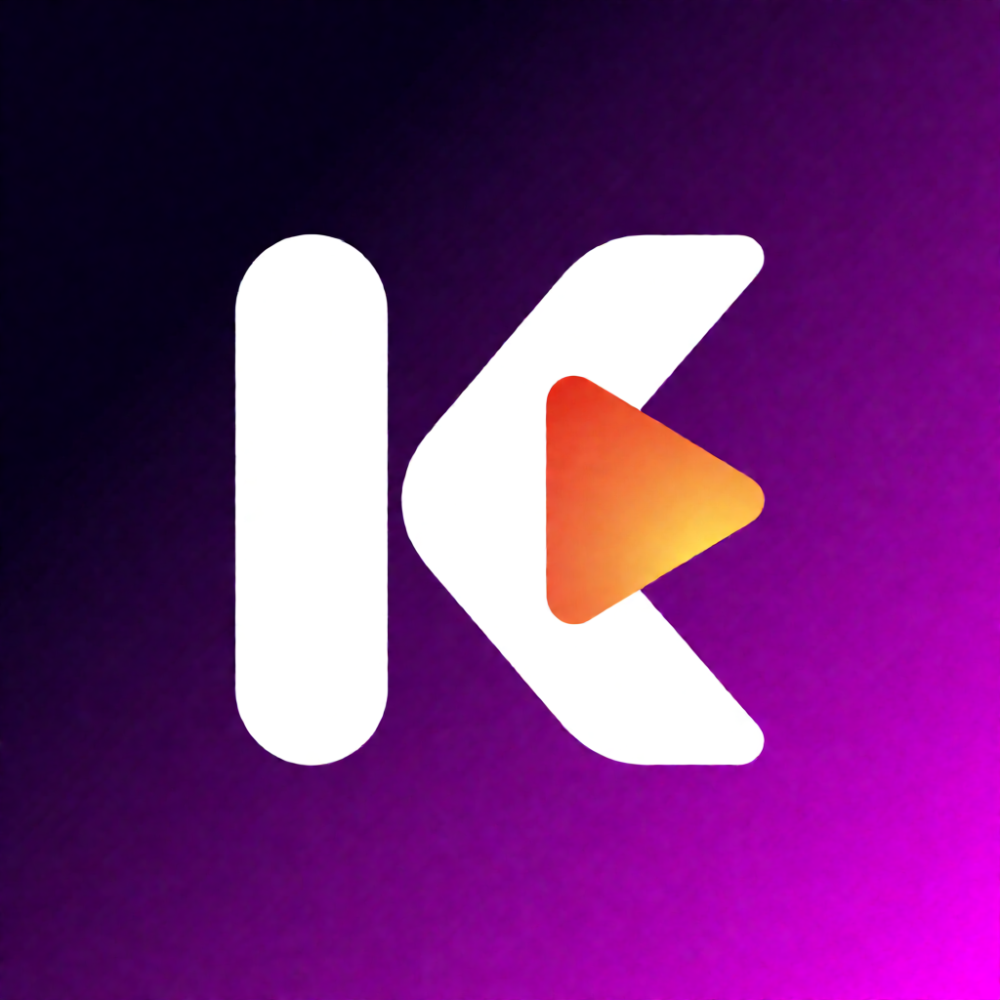

<p align="center">
  
</p>

<h1 align="center">Kastideo</h1>

<p align="center">
  <b>Vos chaînes, vos films et vos séries au même endroit.</b><br>
  Un lecteur IPTV rapide et élégant pour Mac, Windows et Linux.
</p>

<p align="center">
  <a href="https://github.com/jihemezes/kastideo/releases/latest"><b>Télécharger pour Mac</b></a> ·
  <a href="https://github.com/jihemezes/kastideo/releases"><b>Toutes les versions (Windows, Linux)</b></a>
</p>

---

Kastideo réunit votre abonnement IPTV (chaînes en direct, films, séries) dans une seule application claire, rapide et personnalisable : un accueil soigné, un guide TV, des fiches détaillées pour les films, l'enregistrement du direct et bien plus.

> **Kastideo est un lecteur, pas un fournisseur de contenus.** Il ne contient aucune chaîne ni aucun film : vous y ajoutez votre propre abonnement IPTV (Xtream Codes) ou vos playlists M3U.

## Fonctionnalités

### Regarder
- **Direct, Films et Séries** dans une même application, avec favoris, récents et recherche globale.
- **Trois interfaces au choix** : *Classique* (listes), *Cinéma* (affiches, carrousel « à la une ») et *TV* (zapping par numéro, comme sur un téléviseur).
- **Démarrage rapide des chaînes** (moins d'une seconde en général) et indicateur de **santé du flux** (qualité de réception, définition SD / HD / Full HD / 4K).
- **Direct en différé** : mettez en pause, reprenez plus tard, accélérez pour rattraper le direct.
- **Reprise de lecture** des films et des épisodes là où vous vous êtes arrêté.
- **MultiVue** : jusqu'à quatre chaînes à l'écran, si votre abonnement le permet.

### S'y retrouver
- **Guide TV** en grille, avec un guide de secours quand celui du fournisseur est incomplet.
- **Chaînes classées par thème** (Sport et disciplines, Info, Films, Jeunesse, Documentaires…) et vue « En ce moment » / « Ce soir ».
- **Alertes de programme** : Kastideo vous prévient quand votre match ou votre émission commence.
- **Fiches films et séries** : affiche, résumé, distribution, note et bande-annonce (via TMDB).
- **Catégories personnalisables** : réordonner, masquer, renommer ; **correction des chaînes** mal nommées (nom, numéro, logo, guide TV).

### Enregistrer
- **Enregistrement du direct**, immédiat ou programmé, converti en MP4.
- **Téléchargement** des films et des séries pour les regarder sans connexion, éventuellement la nuit.

### Et aussi
- **Sauvegarde et transfert** : un fichier pour retrouver sources, favoris et réglages sur un autre ordinateur, Mac, Windows ou Linux.
- Français et anglais, thème sombre ou clair, couleur d'accent au choix.
- Aide intégrée et journal de lecture pour comprendre un problème de chaîne.
- Mots de passe rangés dans le coffre sécurisé du système ; aucune donnée n'est envoyée ailleurs que chez votre fournisseur (et TMDB pour les fiches, si vous l'activez).

## Les versions de Kastideo

| Plateforme | État | Ce qui est disponible |
|---|---|---|
| **Mac** | ✅ Version stable | Toutes les fonctionnalités ci-dessus, mises à jour automatiques |
| **Windows** | 🧪 Aperçu | Accueil, direct (interfaces Classique et Cinéma, guide TV, thèmes « En ce moment » et « Ce soir »), films et séries (interfaces Classique et Cinéma, fiches TMDB, épisodes, reprise de lecture), réglages, catégories, sauvegarde. Les autres fonctions arrivent par étapes |
| **Linux** (Zorin OS, Ubuntu, Raspberry Pi…) | 🧪 Aperçu | Comme Windows |

Les aperçus Windows et Linux sont publiés en **pré-version** sur la page [Releases](https://github.com/jihemezes/kastideo/releases) (numéros se terminant par `-desktop1`, `-desktop2`…).

## Quelle version télécharger ?

### 🍎 Mac

| Votre Mac | Fichier à télécharger |
|---|---|
| macOS 14 Sonoma ou plus récent, processeur Apple (M1, M2, M3, M4…) ou Intel | `Kastideo-X.Y.Z.dmg` |

*Pour connaître votre version de macOS : menu Pomme > **À propos de ce Mac**.*

Ouvrez le fichier `.dmg` et glissez Kastideo dans **Applications**. L'application est signée et vérifiée par Apple ; elle se met ensuite à jour toute seule.

### 🪟 Windows

| Votre PC | Fichier à télécharger |
|---|---|
| Windows 10 ou 11, 64 bits (processeur Intel ou AMD) | `Kastideo-…-windows-x64.zip` |

*Pour vérifier : **Paramètres > Système > Informations > Type du système** doit indiquer « système d'exploitation 64 bits, processeur x64 ».*

Décompressez l'archive, puis lancez **kastideo.exe**. L'aperçu n'est pas encore signé : Windows affiche « Windows a protégé votre ordinateur » ; cliquez sur **Informations complémentaires** puis **Exécuter quand même**.

### 🐧 Linux

| Votre système | Fichier à télécharger |
|---|---|
| **Zorin OS 17** ou **Ubuntu 22.04** (PC 64 bits) | `kastideo_…_ubuntu22.04_amd64.deb` |
| **Zorin OS 18** ou **Ubuntu 24.04** (PC 64 bits) | `kastideo_…_ubuntu24.04_amd64.deb` |
| **Raspberry Pi 4 ou 5** avec un système 64 bits | `Kastideo-…-linux-aarch64.AppImage` |
| Toute autre distribution (PC 64 bits) | `Kastideo-…-linux-x86_64.AppImage` |

*Pour connaître votre système, tapez dans un terminal :*

```bash
lsb_release -d   # nom et version (par exemple « Zorin OS 17.3 » ou « Ubuntu 24.04 »)
uname -m         # x86_64 = PC 64 bits, aarch64 = Raspberry Pi 64 bits
```

- **Paquet `.deb`** : double-cliquez dessus pour l'installer avec la Logithèque, ou tapez `sudo apt install ./kastideo_…deb` dans le dossier de téléchargement. Kastideo apparaît ensuite dans le menu des applications.
- **AppImage** : un seul fichier, sans installation. Rendez-le exécutable (clic droit > **Propriétés** > **Autoriser l'exécution**, ou `chmod +x Kastideo-…AppImage`) puis double-cliquez dessus. S'il ne démarre pas, installez `libfuse2` (`libfuse2t64` sur Ubuntu 24.04 et Zorin OS 18).

## Premiers pas

1. Lancez Kastideo et ouvrez **Sources** (Réglages sur Mac, bouton antenne sur Windows et Linux).
2. Ajoutez votre abonnement : **Xtream Codes** (adresse du serveur, identifiant, mot de passe) ou **playlist M3U** (adresse ou fichier). Une adresse de playlist du type `get.php?username=…&password=…` est reconnue automatiquement.
3. Vos chaînes, films et séries apparaissent sur l'accueil : choisissez **Direct** et lancez une chaîne.

Tout le reste est expliqué dans l'aide intégrée de l'application (menu **Aide** sur Mac, bouton **?** sur Windows et Linux).

## Besoin d'aide ?

- **Une chaîne ne démarre pas ou n'a pas de son** : ouvrez le **Journal de lecture** (⌥⌘L sur Mac, Ctrl+Alt+L sur Windows et Linux) ; il indique la réponse exacte du fournisseur. Pensez aussi à couper un éventuel VPN.
- **Un problème ou une idée ?** Ouvrez un ticket dans l'onglet [Issues](https://github.com/jihemezes/kastideo/issues).

## Remerciements

Kastideo s'appuie sur des logiciels libres : [VLC / VLCKit](https://www.videolan.org/vlc/libvlc.html) (VideoLAN, LGPL 2.1+) et [Sparkle](https://sparkle-project.org) (MIT) sur Mac ; [Flutter](https://flutter.dev) (BSD), [mpv](https://mpv.io) (LGPL) via [media_kit](https://github.com/media-kit/media-kit) (MIT) sur Windows et Linux ; les polices [Nunito](https://fonts.google.com/specimen/Nunito) et [Inter](https://rsms.me/inter/) (OFL). Les fiches de films et de séries utilisent l'API [TMDB](https://www.themoviedb.org) mais ne sont ni approuvées ni certifiées par TMDB.

<sub>Notes de développement et de publication : [docs/DEVELOPPEMENT.md](docs/DEVELOPPEMENT.md).</sub>
