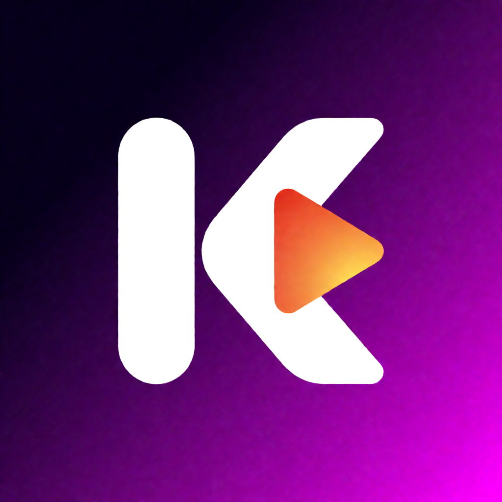

<p align="center">
  
</p>

<h1 align="center">Kastideo</h1>

<p align="center">
  <b>Vos chaînes, vos films et vos séries au même endroit.</b><br>
  Un lecteur IPTV rapide et élégant pour Mac, Windows et Linux.
</p>

<p align="center">
  <a href="https://github.com/jihemezes/kastideo/releases/latest"><b>Télécharger pour Mac</b></a> ·
  <a href="https://github.com/jihemezes/kastideo/releases"><b>Toutes les versions (Windows, Linux)</b></a>
</p>

---

Kastideo réunit votre abonnement IPTV (chaînes en direct, films, séries) dans une seule application claire, rapide et personnalisable : un accueil soigné, un guide TV, des fiches détaillées pour les films, l'enregistrement du direct et bien plus.

> **Kastideo est un lecteur, pas un fournisseur de contenus.** Il ne contient aucune chaîne ni aucun film : vous y ajoutez votre propre abonnement IPTV (Xtream Codes) ou vos playlists M3U.

## Fonctionnalités

### Regarder
- **Direct, Films et Séries** dans une même application, avec favoris, récents et recherche globale.
- **Trois interfaces au choix** : *Classique* (listes), *Cinéma* (affiches, carrousel « à la une ») et *TV* (zapping par numéro, comme sur un téléviseur).
- **Démarrage rapide des chaînes** (moins d'une seconde en général) et indicateur de **santé du flux** (qualité de réception, définition SD / HD / Full HD / 4K).
- **Direct en différé** : mettez en pause, reprenez plus tard, accélérez pour rattraper le direct.
- **Reprise de lecture** des films et des épisodes là où vous vous êtes arrêté.
- **YouTube intégré** : chaînes suivies, recherche (avec votre clé Google gratuite), liens collés, favoris et historique, lus avec le lecteur officiel en « mode confidentialité avancée » (ce n'est pas un bloqueur de publicités).
- **MultiVue** : jusqu'à quatre chaînes à l'écran, si votre abonnement le permet.

### S'y retrouver
- **Guide TV** en grille, avec un guide de secours quand celui du fournisseur est incomplet.
- **Chaînes classées par thème** (Sport et disciplines, Info, Films, Jeunesse, Documentaires…) et vue « En ce moment » / « Ce soir ».
- **Alertes de programme** : Kastideo vous prévient quand votre match ou votre émission commence.
- **Fiches films et séries** : affiche, résumé, distribution, note et bande-annonce (via TMDB).
- **Catégories personnalisables** : réordonner, masquer, renommer ; **correction des chaînes** mal nommées (nom, numéro, logo, guide TV).

### Enregistrer
- **Enregistrement du direct**, immédiat ou programmé, converti en MP4.
- **Téléchargement** des films et des séries pour les regarder sans connexion, éventuellement la nuit.

### Et aussi
- **Sauvegarde et transfert** : un fichier pour retrouver sources, favoris et réglages sur un autre ordinateur, Mac, Windows ou Linux.
- Français et anglais, thème sombre ou clair, couleur d'accent au choix.
- Aide intégrée et journal de lecture pour comprendre un problème de chaîne.
- Mots de passe rangés dans le coffre sécurisé du système ; aucune donnée n'est envoyée ailleurs que chez votre fournisseur (et TMDB pour les fiches, si vous l'activez).

## Les versions de Kastideo

| Plateforme | État | Ce qui est disponible |
|---|---|---|
| **Mac** | ✅ Version stable | Toutes les fonctionnalités ci-dessus, mises à jour automatiques |
| **Mac plus ancien (macOS 12 et 13)** — Kastideo Compat | 🧪 Aperçu | Comme Windows (voir ci-dessous) |
| **iPhone et iPad** (iOS 17 ou plus récent) | 🧪 Aperçu (TestFlight) | Application native : accueil, direct (liste, Cinéma, thèmes, guide TV, replay), films et séries (Cinéma ou grille), lecteur plein écran, mini-lecteur, AirPlay, import de votre configuration, enregistrement du direct, téléchargements, différé, alertes, Mes vidéos (Jellyfin, Emby, Plex, dossiers), YouTube. MultiVue vient ensuite |
| **Windows** | 🧪 Aperçu | Accueil, direct (interfaces Classique, Cinéma et TV, guide TV en grille, thèmes, différé, enregistrement immédiat ou programmé, alertes, correction des chaînes, MultiVue), téléchargements, films et séries (interfaces Classique et Cinéma, fiches TMDB, épisodes, reprise de lecture), thème clair et couleur d'accent, notifications du système, réglages, catégories, sauvegarde, aide complète, installateur Windows et mises à jour intégrées |
| **Linux** (Zorin OS, Ubuntu, Raspberry Pi…) | 🧪 Aperçu | Comme Windows |
| **Android** (téléphone, tablette) et **Android TV** (Google TV, Chromecast avec Google TV, Nvidia Shield, TV Philips, Sony, TCL…) | 🧪 Aperçu | Comme Windows, adapté au doigt (menu ☰, gestes dans le lecteur, appui long) et à la télécommande (interface TV, touches Chaîne, Lecture/Pause) ; Cast en mode direct ; mises à jour intégrées |

Les aperçus Windows et Linux sont publiés en **pré-version** sur la page [Releases](https://github.com/jihemezes/kastideo/releases) (numéros se terminant par `-desktop1`, `-desktop2`…), ceux d'Android et Android TV avec des numéros se terminant par `-android1`, `-android2`…

## Quelle version télécharger ?

### 🍎 Mac

| Votre Mac | Fichier à télécharger |
|---|---|
| macOS 14 Sonoma ou plus récent, processeur Apple (M1, M2, M3, M4…) ou Intel | `Kastideo-X.Y.Z.dmg` |
| **macOS 12 Monterey ou 13 Ventura** (Mac plus ancien), processeur Apple ou Intel — **Kastideo Compat** 🧪 | `Kastideo-Compat-…-macos.dmg` (dans les pré-versions `-desktopN`) |

*Pour connaître votre version de macOS : menu Pomme > **À propos de ce Mac**.*

**Kastideo Compat** est la version « Windows / Linux » (Flutter) recompilée pour Mac : mêmes fonctions et même apparence que sous Windows, pour les Mac qui ne peuvent pas installer la version native (macOS 14 minimum). Elle est signée et notariée ; elle peut s'installer à côté de la version native. Pas de mise à jour automatique : téléchargez la nouvelle version sur la page Releases. Le Cast vers un téléviseur nécessite d'installer ffmpeg (par exemple avec Homebrew : `brew install ffmpeg`).

Ouvrez le fichier `.dmg` et glissez Kastideo dans **Applications**. L'application est signée et vérifiée par Apple ; elle se met ensuite à jour toute seule.

### 🪟 Windows

| Votre PC | Fichier à télécharger |
|---|---|
| Windows 10 ou 11, 64 bits (processeur Intel ou AMD) — **installateur** (recommandé) | `Kastideo-…-windows-x64-setup.exe` |
| Windows 10 ou 11, 64 bits — **version portable** (sans installation) | `Kastideo-…-windows-x64.zip` |

*Pour vérifier : **Paramètres > Système > Informations > Type du système** doit indiquer « système d'exploitation 64 bits, processeur x64 ».*

Lancez l'installateur (installation pour vous seul, sans droits administrateur), ou décompressez l'archive portable et lancez **kastideo.exe**. Kastideo se met ensuite à jour tout seul. L'aperçu n'est pas encore signé : Windows affiche « Windows a protégé votre ordinateur » ; cliquez sur **Informations complémentaires** puis **Exécuter quand même**.

### 🐧 Linux

| Votre système | Fichier à télécharger |
|---|---|
| **Zorin OS 17** ou **Ubuntu 22.04** (PC 64 bits) | `kastideo_…_ubuntu22.04_amd64.deb` |
| **Zorin OS 18** ou **Ubuntu 24.04** (PC 64 bits) | `kastideo_…_ubuntu24.04_amd64.deb` |
| **Raspberry Pi 4 ou 5** avec un système 64 bits | `Kastideo-…-linux-aarch64.AppImage` |
| Toute autre distribution (PC 64 bits) | `Kastideo-…-linux-x86_64.AppImage` |

*Pour connaître votre système, tapez dans un terminal :*

```bash
lsb_release -d   # nom et version (par exemple « Zorin OS 17.3 » ou « Ubuntu 24.04 »)
uname -m         # x86_64 = PC 64 bits, aarch64 = Raspberry Pi 64 bits
```

- **Paquet `.deb`** : double-cliquez dessus pour l'installer avec la Logithèque, ou tapez `sudo apt install ./kastideo_…deb` dans le dossier de téléchargement. Kastideo apparaît ensuite dans le menu des applications.
- **AppImage** : un seul fichier, sans installation. Rendez-le exécutable (clic droit > **Propriétés** > **Autoriser l'exécution**, ou `chmod +x Kastideo-…AppImage`) puis double-cliquez dessus. S'il ne démarre pas, installez `libfuse2` (`libfuse2t64` sur Ubuntu 24.04 et Zorin OS 18).

### 📱 iPhone et iPad

L'application iPhone / iPad est distribuée par **TestFlight** (le service d'Apple pour tester une app avant l'App Store) : on reçoit une invitation, on installe l'app **TestFlight** depuis l'App Store, puis **Kastideo** depuis TestFlight. Les mises à jour arrivent par TestFlight. Pas à pas : page d'aide « Kastideo sur iPhone et iPad ».

### 🤖 Android et Android TV

| Votre appareil | Fichier à télécharger |
|---|---|
| Téléphone, tablette ou boîtier TV **récent** (presque tous) | `Kastideo-…-android-arm64-v8a.apk` |
| Ancien appareil ou boîtier TV 32 bits | `Kastideo-…-android-armeabi-v7a.apk` |
| Vous hésitez | `Kastideo-…-android-universal.apk` (plus volumineux, fonctionne partout) |

Kastideo n'est pas sur Google Play : on télécharge l'**APK** et on l'ouvre. Android demande alors d'autoriser **l'application qui ouvre le fichier** (navigateur, gestionnaire de fichiers, Downloader) à installer des applications : c'est une autorisation pour cette seule application, il n'y a rien à désactiver dans les protections d'Android. Si Play Protect signale un développeur inconnu : **Plus de détails > Installer quand même**.

Sur **Android TV**, le plus simple est l'application gratuite **Downloader** (saisissez l'adresse du fichier APK), ou une clé USB. Les APK sont tous signés avec la même clé : les mises à jour s'installent par-dessus, depuis Kastideo lui-même. Pas à pas : page d'aide « Kastideo sur Android et Android TV » ou [docs/ANDROID.md](docs/ANDROID.md).

<p align="center"><br><sub>Scannez avec le téléphone pour ouvrir la page de téléchargement de l'APK.</sub></p>

## Premiers pas

1. Lancez Kastideo et ouvrez **Sources** (Réglages sur Mac, bouton antenne sur Windows et Linux).
2. Ajoutez votre abonnement : **Xtream Codes** (adresse du serveur, identifiant, mot de passe) ou **playlist M3U** (adresse ou fichier). Une adresse de playlist du type `get.php?username=…&password=…` est reconnue automatiquement.
3. Vos chaînes, films et séries apparaissent sur l'accueil : choisissez **Direct** et lancez une chaîne.

Tout le reste est expliqué dans l'aide intégrée de l'application (menu **Aide** sur Mac, bouton **?** sur Windows et Linux).

## Besoin d'aide ?

- **Une chaîne ne démarre pas ou n'a pas de son** : ouvrez le **Journal de lecture** (⌥⌘L sur Mac, Ctrl+Alt+L sur Windows et Linux) ; il indique la réponse exacte du fournisseur. Pensez aussi à couper un éventuel VPN.
- **Un problème ou une idée ?** Ouvrez un ticket dans l'onglet [Issues](https://github.com/jihemezes/kastideo/issues).

## Avertissement

Merci d'utiliser Kastideo. Kastideo est un lecteur multimédia : il lit les listes de lecture (M3U), les comptes IPTV (Xtream Codes), vos serveurs personnels (Jellyfin, Emby, Plex), les vidéos de vos disques et YouTube.

- **Aucun contenu fourni.** Kastideo ne fournit, n'héberge ni ne vend aucune chaîne, aucun film, aucune liste de lecture ni aucun abonnement.
- **Aucune affiliation.** Kastideo n'est affilié à aucun fournisseur de contenus ou d'abonnements IPTV, ni à YouTube, Google, TMDB, Plex, Jellyfin, Emby, Apple ou Microsoft. Les marques citées appartiennent à leurs propriétaires. Ce produit utilise l'API TMDB mais n'est ni approuvé ni certifié par TMDB.
- **Vos propres contenus.** Vous devez fournir vos propres sources et contenus. Vous êtes seul responsable de vérifier qu'ils sont légaux et que vous avez tous les droits nécessaires pour les regarder, les enregistrer, les télécharger et les diffuser.
- **Droit d'auteur.** Kastideo n'encourage pas la diffusion de contenus protégés par le droit d'auteur sans l'autorisation de leurs titulaires. Les enregistrements, les téléchargements et la diffusion vers un téléviseur (Cast) sont réservés à un usage privé, dans les limites de la loi de votre pays.
- **Responsabilité.** L'auteur de Kastideo n'est pas responsable de l'usage que vous faites du logiciel, ni du contenu, de la disponibilité ou de la légalité des services tiers auxquels vous le connectez. Kastideo est fourni gratuitement, « tel quel », sans garantie.
- **Vos données.** Vos identifiants sont conservés sur votre appareil et ne sont transmis qu'aux services que vous configurez.

En cliquant sur « J'ai compris et j'accepte », vous reconnaissez avoir lu ces conditions et vous les acceptez. Dans le cas contraire, quittez l'application.

<details>
<summary>English</summary>

Thank you for using Kastideo. Kastideo is a media player: it plays playlists (M3U), IPTV accounts (Xtream Codes), your own servers (Jellyfin, Emby, Plex), the videos on your drives and YouTube.

- **No content provided.** Kastideo does not provide, host or sell any channel, movie, playlist or subscription.
- **No affiliation.** Kastideo is not affiliated with any content or IPTV subscription provider, nor with YouTube, Google, TMDB, Plex, Jellyfin, Emby, Apple or Microsoft. Trademarks mentioned belong to their respective owners. This product uses the TMDB API but is not endorsed or certified by TMDB.
- **Your own content.** You must supply your own sources and content. You are solely responsible for checking that they are legal and that you have all the rights needed to watch, record, download and stream them.
- **Copyright.** Kastideo does not encourage the streaming of copyright-protected material without the permission of the copyright holder. Recordings, downloads and casting to a TV are for private use only, within the limits of the law in your country.
- **Liability.** The author of Kastideo is not responsible for how you use the software, nor for the content, availability or legality of the third-party services you connect it to. Kastideo is provided free of charge, “as is”, without warranty.
- **Your data.** Your credentials are kept on your device and are only sent to the services you configure.

By clicking “I understand and accept”, you confirm that you have read and accept these terms. Otherwise, please quit the application.

</details>

## Soutenir Kastideo

Kastideo est **gratuit**. Si l'application vous plaît, vous pouvez encourager son développement — c'est entièrement facultatif :

<p align="center">
  <a href="https://ko-fi.com/jihemezes"></a>
</p>

## Remerciements

Kastideo s'appuie sur des logiciels libres : [VLC / VLCKit](https://www.videolan.org/vlc/libvlc.html) (VideoLAN, LGPL 2.1+) et [Sparkle](https://sparkle-project.org) (MIT) sur Mac ; [Flutter](https://flutter.dev) (BSD), [mpv](https://mpv.io) (LGPL) via [media_kit](https://github.com/media-kit/media-kit) (MIT) sur Windows et Linux ; les polices [Nunito](https://fonts.google.com/specimen/Nunito) et [Inter](https://rsms.me/inter/) (OFL). Les fiches de films et de séries utilisent l'API [TMDB](https://www.themoviedb.org) mais ne sont ni approuvées ni certifiées par TMDB.

<sub>Notes de développement et de publication : [docs/DEVELOPPEMENT.md](docs/DEVELOPPEMENT.md).</sub>
