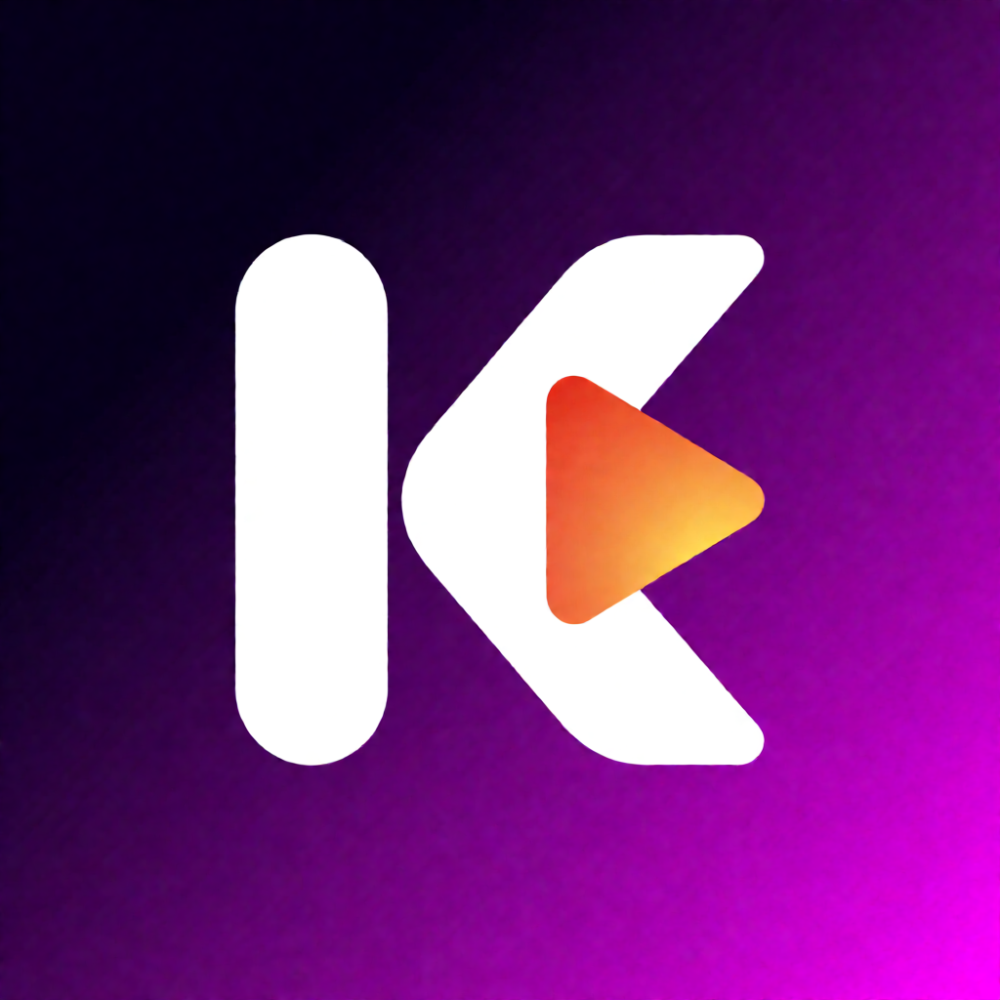

<h1 align="center">Kastideo</h1>

<b>Ihre Sender, Filme und Serien an einem Ort.</b> Ein schneller, eleganter IPTV-Player für Mac, Windows, Linux, iPhone, iPad, Apple TV und Android.

<a href="https://github.com/jihemezes/kastideo/releases/latest"><b>Für Mac laden</b></a> · <a href="https://github.com/jihemezes/kastideo/releases"><b>Alle Versionen (Windows, Linux, Android)</b></a>

[English](README.en.md) · [Español](README.es.md) · **Deutsch** · [Italiano](README.it.md) · [Português](README.pt.md) · [Français](../../README.md)

---

Kastideo vereint Ihr IPTV-Abo (Live-Sender, Filme, Serien) in einer klaren, schnellen und anpassbaren App: ein gepflegter Startbildschirm, ein TV-Programm, ausführliche Filmseiten, Live-Aufnahme und vieles mehr.

> **Kastideo ist ein Player, kein Inhalteanbieter.** Es enthält keinen Sender und keinen Film: Sie fügen Ihr eigenes IPTV-Abo (Xtream Codes) oder Ihre M3U-Playlists hinzu.

## Funktionen

- **Live, Filme und Serien** in einer App, mit Favoriten, Zuletzt gesehen und globaler Suche.
- **Drei Oberflächen**: *Klassisch* (Listen), *Kino* (Poster, Aufmacher-Karussell) und *TV* (Zappen per Nummer).
- **Schneller Sender-Start** und Anzeige der **Stream-Qualität** (SD / HD / Full HD / 4K).
- **Zeitversetztes Live-Fernsehen**: pausieren, später fortsetzen, zum Live-Bild aufholen.
- **Wiedergabe fortsetzen** bei Filmen und Folgen.
- **YouTube integriert** (offizieller Player, mit Ihrem kostenlosen Google-Schlüssel).
- **MultiView**: bis zu vier Sender gleichzeitig, wenn Ihr Abo es erlaubt.
- **TV-Programm** als Raster, Sendungserinnerungen, Sender nach Themen sortiert.
- **Film- und Serienseiten** (Poster, Zusammenfassung, Besetzung, Trailer über TMDB).
- **Live-Aufnahme** (sofort oder geplant) und **Downloads** zum Ansehen ohne Verbindung.
- **Sicherung und Übertragung** von Quellen, Favoriten und Einstellungen zwischen Geräten.
- **Sprachen**: Französisch, Englisch, Spanisch, Deutsch, Italienisch und Portugiesisch; dunkles oder helles Design.
- Passwörter im System-Schlüsselbund; Daten gehen nur an Ihren Anbieter (und an TMDB für die Seiten, wenn Sie es aktivieren).

## Plattformen

- **Mac** (macOS 14+): stabile Version, automatische Updates. **Kastideo Compat** für macOS 12 und 13 (Vorschau).
- **iPhone und iPad** (iOS 17+) sowie **Apple TV**: Vorschauen über TestFlight.
- **Windows 10/11**, **Linux** (Ubuntu, Zorin OS, Raspberry Pi …), **Android** und **Android TV**: Vorschauen, siehe Seite Releases.

## Erste Schritte

1. Starten Sie Kastideo und öffnen Sie **Quellen**.
2. Fügen Sie Ihr Abo (**Xtream Codes**) oder eine **M3U-Playlist** (URL oder Datei) hinzu.
3. Ihre Sender, Filme und Serien erscheinen auf dem Startbildschirm.

## Hilfe

Die vollständige Hilfe ist in die App integriert (Menü Hilfe auf dem Mac, Schaltfläche **?** sonst) und in allen sechs Sprachen verfügbar. Startet ein Sender nicht, öffnen Sie das **Wiedergabeprotokoll** (⌥⌘L auf dem Mac, Strg+Alt+L unter Windows und Linux). Probleme und Ideen: [Issues](https://github.com/jihemezes/kastideo/issues).

## Hinweis

- **Keine Inhalte.** Kastideo liefert, hostet oder verkauft keine Sender, Filme, Playlists oder Abos.
- **Keine Verbindung.** Kastideo ist weder mit Inhalte- oder IPTV-Anbietern noch mit YouTube, Google, TMDB, Plex, Jellyfin, Emby, Apple oder Microsoft verbunden. Dieses Produkt nutzt die TMDB-API, wird aber von TMDB weder unterstützt noch zertifiziert.
- **Ihre eigenen Inhalte.** Sie allein sind dafür verantwortlich, dass Ihre Quellen legal sind und Sie die nötigen Rechte zum Ansehen, Aufnehmen, Herunterladen und Streamen haben.
- **Urheberrecht.** Aufnahmen, Downloads und Übertragung auf einen Fernseher sind nur für den privaten Gebrauch im Rahmen der Gesetze Ihres Landes bestimmt.
- **Haftung.** Der Autor haftet nicht für Ihre Nutzung der Software oder für Dienste Dritter. Kastideo wird „wie besehen“ ohne Gewähr bereitgestellt.
- **Ihre Daten.** Ihre Zugangsdaten bleiben auf Ihrem Gerät und werden nur an die von Ihnen eingerichteten Dienste gesendet.

[Datenschutzerklärung](../PRIVACY.md) · [Vollständiges README (Französisch und Englisch)](../../README.md)
