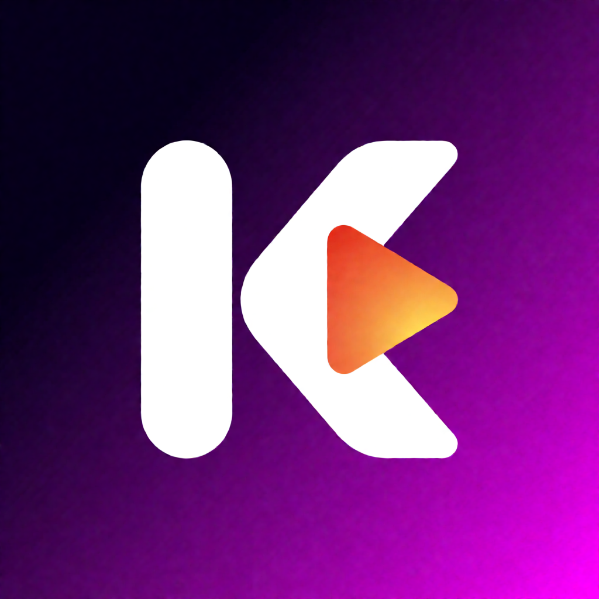

<h1 align="center">Kastideo</h1>

<b>Your channels, movies and series in one place.</b> A fast, elegant IPTV player for Mac, Windows, Linux, iPhone, iPad, Apple TV and Android.

<a href="https://github.com/jihemezes/kastideo/releases/latest"><b>Download for Mac</b></a> · <a href="https://github.com/jihemezes/kastideo/releases"><b>All versions (Windows, Linux, Android)</b></a>

**English** · [Español](README.es.md) · [Deutsch](README.de.md) · [Italiano](README.it.md) · [Português](README.pt.md) · [Français](../../README.md)

---

Kastideo brings your IPTV subscription (live channels, movies, series) together in one clear, fast, customizable app: a polished home screen, a TV guide, detailed movie pages, live recording and much more.

> **Kastideo is a player, not a content provider.** It contains no channel or movie: you add your own IPTV subscription (Xtream Codes) or M3U playlists.

## Features

- **Live, Movies and Series** in one app, with favorites, recents and global search.
- **Three interfaces**: *Classic* (lists), *Cinema* (posters, featured carousel) and *TV* (zapping by number).
- **Fast channel start** and a **stream health** indicator (SD / HD / Full HD / 4K).
- **Time-shifted live**: pause, resume later, catch up with the live broadcast.
- **Resume playback** of movies and episodes.
- **Built-in YouTube** (official player, with your free Google key).
- **MultiView**: up to four channels on screen, if your subscription allows it.
- **TV guide** in a grid, programme alerts, channels sorted by theme.
- **Movie and series pages** (poster, summary, cast, trailer via TMDB).
- **Live recording** (immediate or scheduled) and **downloads** for offline viewing.
- **Backup and transfer** of sources, favorites and settings between devices.
- **Languages**: French, English, Spanish, German, Italian and Portuguese; dark or light theme.
- Passwords kept in the system keychain; no data is sent anywhere except to your provider (and TMDB for the pages, if you enable it).

## Platforms

- **Mac** (macOS 14+): stable version, automatic updates. **Kastideo Compat** for macOS 12 and 13 (preview).
- **iPhone and iPad** (iOS 17+) and **Apple TV**: previews through TestFlight.
- **Windows 10/11**, **Linux** (Ubuntu, Zorin OS, Raspberry Pi…), **Android** and **Android TV**: previews, see the Releases page.

## Getting started

1. Launch Kastideo and open **Sources**.
2. Add your subscription (**Xtream Codes**) or an **M3U playlist** (URL or file).
3. Your channels, movies and series appear on the home screen.

## Help

The full help is built into the app (Help menu on Mac, **?** button elsewhere) in all six languages. For a channel that won't start, open the **Playback log** (⌥⌘L on Mac, Ctrl+Alt+L on Windows and Linux). Issues and ideas: [Issues](https://github.com/jihemezes/kastideo/issues).

## Disclaimer

- **No content provided.** Kastideo does not provide, host or sell any channel, movie, playlist or subscription.
- **No affiliation.** Kastideo is not affiliated with any content or IPTV provider, nor with YouTube, Google, TMDB, Plex, Jellyfin, Emby, Apple or Microsoft. This product uses the TMDB API but is not endorsed or certified by TMDB.
- **Your own content.** You are solely responsible for checking that your sources are legal and that you have the rights needed to watch, record, download and stream them.
- **Copyright.** Recordings, downloads and casting are for private use only, within the limits of the law in your country.
- **Liability.** The author is not responsible for how you use the software or for third-party services. Kastideo is provided “as is”, without warranty.
- **Your data.** Your credentials stay on your device and are only sent to the services you configure.

[Privacy policy](../PRIVACY.md) · [Full README (French and English)](../../README.md)
