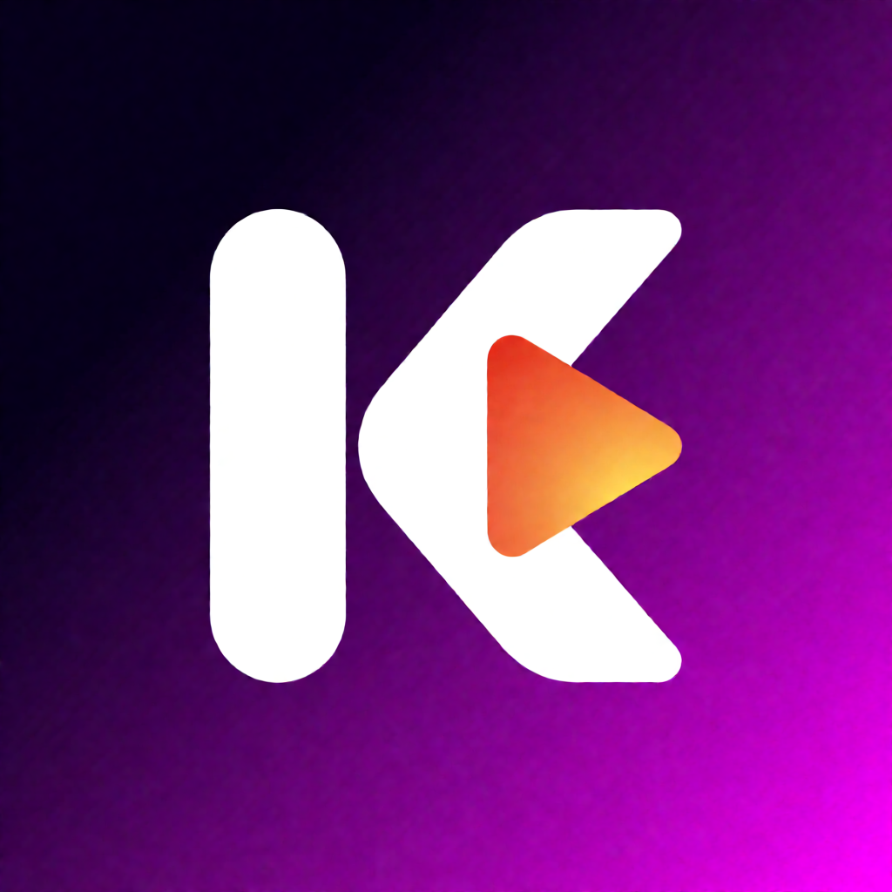

<h1 align="center">Kastideo</h1>

<b>Sus canales, películas y series en un solo lugar.</b> Un reproductor IPTV rápido y elegante para Mac, Windows, Linux, iPhone, iPad, Apple TV y Android.

<a href="https://github.com/jihemezes/kastideo/releases/latest"><b>Descargar para Mac</b></a> · <a href="https://github.com/jihemezes/kastideo/releases"><b>Todas las versiones (Windows, Linux, Android)</b></a>

[English](README.en.md) · **Español** · [Deutsch](README.de.md) · [Italiano](README.it.md) · [Português](README.pt.md) · [Français](../../README.md)

---

Kastideo reúne su suscripción IPTV (canales en directo, películas, series) en una sola aplicación clara, rápida y personalizable: un inicio cuidado, una guía TV, fichas detalladas de películas, grabación del directo y mucho más.

> **Kastideo es un reproductor, no un proveedor de contenidos.** No contiene ningún canal ni película: usted añade su propia suscripción IPTV (Xtream Codes) o sus listas M3U.

## Funciones

- **Directo, Películas y Series** en una sola aplicación, con favoritos, recientes y búsqueda global.
- **Tres interfaces**: *Clásica* (listas), *Cine* (carteles, carrusel destacado) y *TV* (zapping por número).
- **Inicio rápido de los canales** e indicador de **salud del flujo** (SD / HD / Full HD / 4K).
- **Directo en diferido**: pause, reanude más tarde, alcance la emisión en directo.
- **Reanudar la reproducción** de películas y episodios.
- **YouTube integrado** (reproductor oficial, con su clave gratuita de Google).
- **MultiVista**: hasta cuatro canales en pantalla, si su suscripción lo permite.
- **Guía TV** en cuadrícula, alertas de programas, canales clasificados por tema.
- **Fichas de películas y series** (cartel, sinopsis, reparto, tráiler vía TMDB).
- **Grabación del directo** (inmediata o programada) y **descargas** para ver sin conexión.
- **Copia de seguridad y traslado** de fuentes, favoritos y ajustes entre dispositivos.
- **Idiomas**: francés, inglés, español, alemán, italiano y portugués; tema oscuro o claro.
- Contraseñas en el llavero del sistema; ningún dato se envía a otro sitio que su proveedor (y TMDB para las fichas, si lo activa).

## Plataformas

- **Mac** (macOS 14+): versión estable, actualizaciones automáticas. **Kastideo Compat** para macOS 12 y 13 (vista previa).
- **iPhone y iPad** (iOS 17+) y **Apple TV**: vistas previas mediante TestFlight.
- **Windows 10/11**, **Linux** (Ubuntu, Zorin OS, Raspberry Pi…), **Android** y **Android TV**: vistas previas, véase la página Releases.

## Primeros pasos

1. Abra Kastideo y vaya a **Fuentes**.
2. Añada su suscripción (**Xtream Codes**) o una **lista M3U** (URL o archivo).
3. Sus canales, películas y series aparecen en el inicio.

## Ayuda

La ayuda completa está integrada en la aplicación (menú Ayuda en Mac, botón **?** en las demás) en los seis idiomas. Si un canal no arranca, abra el **Registro de reproducción** (⌥⌘L en Mac, Ctrl+Alt+L en Windows y Linux). Problemas e ideas: [Issues](https://github.com/jihemezes/kastideo/issues).

## Aviso legal

- **Ningún contenido proporcionado.** Kastideo no proporciona, aloja ni vende ningún canal, película, lista de reproducción ni suscripción.
- **Sin afiliación.** Kastideo no está afiliado a ningún proveedor de contenidos o de suscripciones IPTV, ni a YouTube, Google, TMDB, Plex, Jellyfin, Emby, Apple o Microsoft. Este producto utiliza la API de TMDB pero no está respaldado ni certificado por TMDB.
- **Sus propios contenidos.** Usted es el único responsable de comprobar que sus fuentes son legales y de contar con los derechos necesarios para verlas, grabarlas, descargarlas y transmitirlas.
- **Derechos de autor.** Las grabaciones, descargas y la emisión a un televisor son solo para uso privado, dentro de los límites de la ley de su país.
- **Responsabilidad.** El autor no es responsable del uso que haga del software ni de los servicios de terceros. Kastideo se proporciona «tal cual», sin garantía.
- **Sus datos.** Sus credenciales permanecen en su dispositivo y solo se envían a los servicios que usted configura.

[Política de privacidad](../PRIVACY.md) · [README completo (francés e inglés)](../../README.md)
