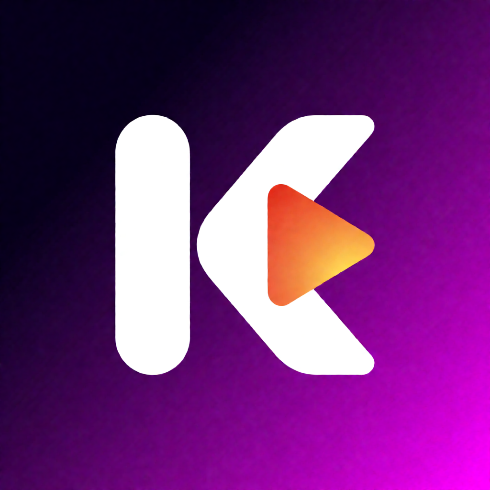

<h1 align="center">Kastideo</h1>

<b>I vostri canali, film e serie in un unico posto.</b> Un lettore IPTV veloce ed elegante per Mac, Windows, Linux, iPhone, iPad, Apple TV e Android.

<a href="https://github.com/jihemezes/kastideo/releases/latest"><b>Scarica per Mac</b></a> · <a href="https://github.com/jihemezes/kastideo/releases"><b>Tutte le versioni (Windows, Linux, Android)</b></a>

[English](README.en.md) · [Español](README.es.md) · [Deutsch](README.de.md) · **Italiano** · [Português](README.pt.md) · [Français](../../README.md)

---

Kastideo riunisce il vostro abbonamento IPTV (canali in diretta, film, serie) in un'unica app chiara, veloce e personalizzabile: una home curata, una guida TV, schede dettagliate dei film, registrazione della diretta e molto altro.

> **Kastideo è un lettore, non un fornitore di contenuti.** Non contiene alcun canale né film: aggiungete il vostro abbonamento IPTV (Xtream Codes) o le vostre playlist M3U.

## Funzioni

- **Diretta, Film e Serie** in un'unica app, con preferiti, recenti e ricerca globale.
- **Tre interfacce**: *Classica* (liste), *Cinema* (locandine, carosello in evidenza) e *TV* (zapping per numero).
- **Avvio rapido dei canali** e indicatore di **stato del flusso** (SD / HD / Full HD / 4K).
- **Diretta in differita**: pausa, ripresa più tardi, recupero fino alla diretta.
- **Ripresa della riproduzione** di film ed episodi.
- **YouTube integrato** (lettore ufficiale, con la vostra chiave Google gratuita).
- **MultiVista**: fino a quattro canali sullo schermo, se l'abbonamento lo consente.
- **Guida TV** a griglia, avvisi sui programmi, canali ordinati per tema.
- **Schede di film e serie** (locandina, trama, cast, trailer tramite TMDB).
- **Registrazione della diretta** (immediata o programmata) e **download** per guardare senza connessione.
- **Backup e trasferimento** di sorgenti, preferiti e impostazioni tra dispositivi.
- **Lingue**: francese, inglese, spagnolo, tedesco, italiano e portoghese; tema scuro o chiaro.
- Password nel portachiavi di sistema; nessun dato viene inviato se non al vostro fornitore (e a TMDB per le schede, se lo attivate).

## Piattaforme

- **Mac** (macOS 14+): versione stabile, aggiornamenti automatici. **Kastideo Compat** per macOS 12 e 13 (anteprima).
- **iPhone e iPad** (iOS 17+) e **Apple TV**: anteprime tramite TestFlight.
- **Windows 10/11**, **Linux** (Ubuntu, Zorin OS, Raspberry Pi…), **Android** e **Android TV**: anteprime, vedere la pagina Releases.

## Primi passi

1. Avviate Kastideo e aprite **Sorgenti**.
2. Aggiungete l'abbonamento (**Xtream Codes**) o una **playlist M3U** (URL o file).
3. Canali, film e serie compaiono nella home.

## Aiuto

La guida completa è integrata nell'app (menu Aiuto su Mac, pulsante **?** altrove) nelle sei lingue. Se un canale non parte, aprite il **Registro di riproduzione** (⌥⌘L su Mac, Ctrl+Alt+L su Windows e Linux). Problemi e idee: [Issues](https://github.com/jihemezes/kastideo/issues).

## Avvertenza

- **Nessun contenuto fornito.** Kastideo non fornisce, ospita né vende alcun canale, film, playlist o abbonamento.
- **Nessuna affiliazione.** Kastideo non è affiliato ad alcun fornitore di contenuti o abbonamenti IPTV, né a YouTube, Google, TMDB, Plex, Jellyfin, Emby, Apple o Microsoft. Questo prodotto usa l'API di TMDB ma non è approvato né certificato da TMDB.
- **I vostri contenuti.** Siete gli unici responsabili della legalità delle vostre sorgenti e di avere i diritti necessari per guardarle, registrarle, scaricarle e trasmetterle.
- **Diritto d'autore.** Registrazioni, download e trasmissione su un televisore sono riservati all'uso privato, nei limiti della legge del vostro paese.
- **Responsabilità.** L'autore non è responsabile dell'uso del software né dei servizi di terzi. Kastideo è fornito «così com'è», senza garanzia.
- **I vostri dati.** Le credenziali restano sul dispositivo e sono inviate solo ai servizi che configurate.

[Informativa sulla privacy](../PRIVACY.md) · [README completo (francese e inglese)](../../README.md)
