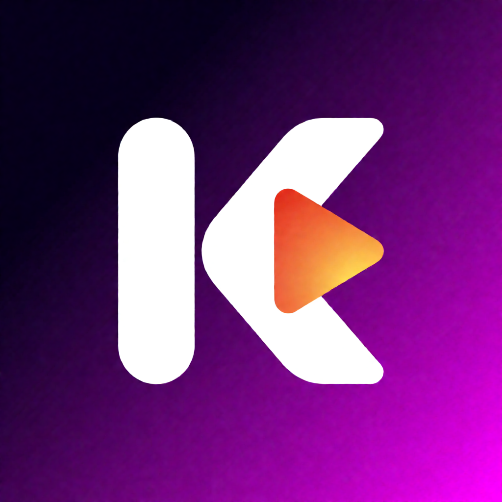

<h1 align="center">Kastideo</h1>

<b>Seus canais, filmes e séries num só lugar.</b> Um player IPTV rápido e elegante para Mac, Windows, Linux, iPhone, iPad, Apple TV e Android.

<a href="https://github.com/jihemezes/kastideo/releases/latest"><b>Baixar para Mac</b></a> · <a href="https://github.com/jihemezes/kastideo/releases"><b>Todas as versões (Windows, Linux, Android)</b></a>

[English](README.en.md) · [Español](README.es.md) · [Deutsch](README.de.md) · [Italiano](README.it.md) · **Português** · [Français](../../README.md)

---

O Kastideo reúne a sua assinatura IPTV (canais ao vivo, filmes, séries) num único aplicativo claro, rápido e personalizável: uma tela inicial cuidada, um guia de TV, páginas detalhadas de filmes, gravação do ao vivo e muito mais.

> **O Kastideo é um player, não um fornecedor de conteúdos.** Não contém nenhum canal nem filme: você adiciona a sua própria assinatura IPTV (Xtream Codes) ou as suas listas M3U.

## Funcionalidades

- **Ao vivo, Filmes e Séries** num só aplicativo, com favoritos, recentes e busca global.
- **Três interfaces**: *Clássica* (listas), *Cinema* (pôsteres, carrossel em destaque) e *TV* (zapping por número).
- **Início rápido dos canais** e indicador de **saúde do fluxo** (SD / HD / Full HD / 4K).
- **Ao vivo com atraso**: pause, retome depois, alcance a transmissão ao vivo.
- **Retomar a reprodução** de filmes e episódios.
- **YouTube integrado** (player oficial, com a sua chave gratuita do Google).
- **MultiVista**: até quatro canais na tela, se a assinatura permitir.
- **Guia de TV** em grade, alertas de programas, canais organizados por tema.
- **Páginas de filmes e séries** (pôster, sinopse, elenco, trailer via TMDB).
- **Gravação do ao vivo** (imediata ou programada) e **downloads** para assistir sem conexão.
- **Backup e transferência** de fontes, favoritos e ajustes entre dispositivos.
- **Idiomas**: francês, inglês, espanhol, alemão, italiano e português; tema escuro ou claro.
- Senhas no chaveiro do sistema; nenhum dado é enviado além do seu provedor (e do TMDB para as páginas, se você ativar).

## Plataformas

- **Mac** (macOS 14+): versão estável, atualizações automáticas. **Kastideo Compat** para macOS 12 e 13 (prévia).
- **iPhone e iPad** (iOS 17+) e **Apple TV**: prévias via TestFlight.
- **Windows 10/11**, **Linux** (Ubuntu, Zorin OS, Raspberry Pi…), **Android** e **Android TV**: prévias, veja a página Releases.

## Primeiros passos

1. Abra o Kastideo e vá em **Fontes**.
2. Adicione a sua assinatura (**Xtream Codes**) ou uma **lista M3U** (URL ou arquivo).
3. Seus canais, filmes e séries aparecem na tela inicial.

## Ajuda

A ajuda completa está integrada ao aplicativo (menu Ajuda no Mac, botão **?** nos demais) nos seis idiomas. Se um canal não iniciar, abra o **Registro de reprodução** (⌥⌘L no Mac, Ctrl+Alt+L no Windows e no Linux). Problemas e ideias: [Issues](https://github.com/jihemezes/kastideo/issues).

## Aviso legal

- **Nenhum conteúdo fornecido.** O Kastideo não fornece, hospeda nem vende canais, filmes, listas de reprodução ou assinaturas.
- **Sem afiliação.** O Kastideo não é afiliado a nenhum provedor de conteúdos ou de assinaturas IPTV, nem ao YouTube, Google, TMDB, Plex, Jellyfin, Emby, Apple ou Microsoft. Este produto usa a API do TMDB, mas não é endossado nem certificado pelo TMDB.
- **Seus próprios conteúdos.** Você é o único responsável por verificar que as suas fontes são legais e que tem os direitos necessários para assistir, gravar, baixar e transmitir.
- **Direitos autorais.** Gravações, downloads e transmissão para a TV são apenas para uso privado, dentro dos limites da lei do seu país.
- **Responsabilidade.** O autor não é responsável pelo uso que você faz do software nem pelos serviços de terceiros. O Kastideo é fornecido «como está», sem garantia.
- **Seus dados.** As suas credenciais ficam no seu dispositivo e só são enviadas aos serviços que você configurar.

[Política de privacidade](../PRIVACY.md) · [README completo (francês e inglês)](../../README.md)
